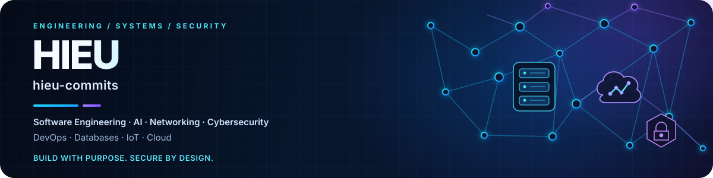
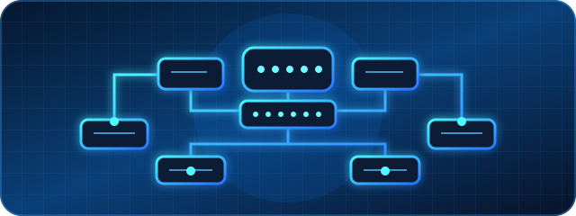
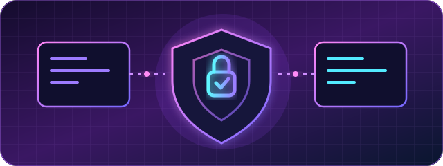
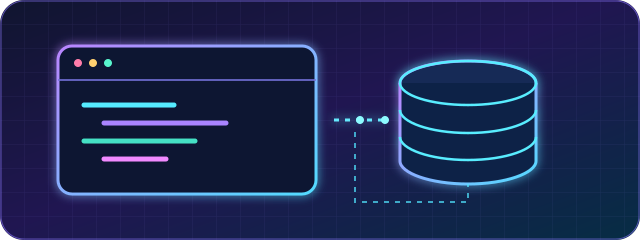
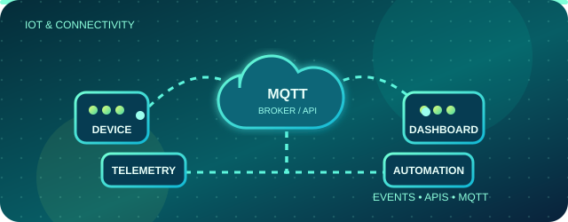

<!--
  GitHub Profile README — hieu-commits
  Keep this file at the repository root. Upload the assets/ directory too.
  Replace/remove technologies and project tracks so they match your actual experience.
-->

  

  <strong>SOFTWARE ENGINEERING&nbsp; · &nbsp;NETWORKING&nbsp; · &nbsp;CYBERSECURITY&nbsp; · &nbsp;DEVOPS&nbsp; · &nbsp;DATABASES&nbsp; · &nbsp;IoT&nbsp; · &nbsp;CLOUD</strong>

  
  
  

  <em>Connecting software, infrastructure and data — building systems that are useful, reliable and secure.</em>

---

## ◈ About Me

I'm an IT enthusiast exploring how software and infrastructure fit together — from application logic and databases to networks, cloud platforms and security controls. I learn by building labs, testing ideas, troubleshooting failures and documenting what works.

- `01` **Software Engineering** — clean code, APIs, automation and maintainable applications
- `02` **Networking** — TCP/IP, routing, switching, VLANs and troubleshooting
- `03` **Cybersecurity** — traffic analysis, access control, hardening and defensive practices
- `04` **DevOps & Cloud** — Linux, containers, CI/CD concepts and infrastructure automation
- `05` **Databases** — SQL, schema design, queries and data integrity
- `06` **IoT** — device connectivity, MQTT, telemetry and service integration

> I value practical understanding over buzzwords: build it, test it, document it, improve it.

---

## ◈ Tech Stack

<table>
  <tr>
    <td width="50%" valign="top">
      <h3>⌘ Software Engineering</h3>
      
      
      
      
    </td>
    <td width="50%" valign="top">
      <h3>⌁ Networking</h3>
      
      
      
      
      
    </td>
  </tr>
  <tr>
    <td valign="top">
      <h3>⛨ Cybersecurity</h3>
      
      
      
      
    </td>
    <td valign="top">
      <h3>∞ DevOps & Cloud</h3>
      
      
      
      
    </td>
  </tr>
  <tr>
    <td valign="top">
      <h3>▤ Databases</h3>
      
      
      
    </td>
    <td valign="top">
      <h3>⌁ IoT & Connected Systems</h3>
      
      
      
    </td>
  </tr>
</table>

Stack badges describe my technical interests and tools I explore; the projects and repositories are the best way to evaluate hands-on experience.

---

## ◈ Featured Project Tracks

These cards represent the areas I'm building and documenting. Until a dedicated repository exists, the links lead to my repository list.

<table>
  <tr>
    <td width="33.33%" valign="top">
      
      <h3>01 / Network Infrastructure</h3>
      
Routing, switching, VLAN segmentation, WAN failover, firewall policy and structured troubleshooting.

      
  

      <a href="https://github.com/hieu-commits?tab=repositories">Explore repositories ↗</a>
    </td>
    <td width="33.33%" valign="top">
      
      <h3>02 / Cybersecurity</h3>
      
Packet inspection, firewall controls, access policy, security baselines and defensive lab exercises.

      
  

      <a href="https://github.com/hieu-commits?tab=repositories">Explore repositories ↗</a>
    </td>
    <td width="33.33%" valign="top">
      
      <h3>03 / DevOps & Cloud</h3>
      
Container workflows, CI/CD practice, Linux services, deployment automation and cloud architecture.

      
  

      <a href="https://github.com/hieu-commits?tab=repositories">Explore repositories ↗</a>
    </td>
  </tr>
  <tr>
    <td width="33.33%" valign="top">
      
      <h3>04 / Software & Data</h3>
      
Application logic, reusable code, API integration, SQL queries and relational data modeling.

      
  

      <a href="https://github.com/hieu-commits?tab=repositories">Explore repositories ↗</a>
    </td>
    <td width="33.33%" valign="top">
      
      <h3>05 / IoT Connectivity</h3>
      
MQTT messaging, device-to-service communication, telemetry flows and integration with network services.

      
  

      <a href="https://github.com/hieu-commits?tab=repositories">Explore repositories ↗</a>
    </td>
    <td width="33.33%" valign="top">
      <h3>06 / Lab Notes</h3>
      
Short write-ups covering what I built, what failed, how I diagnosed it and what I learned.

      
 

      <a href="https://github.com/hieu-commits?tab=repositories">Browse lab notes ↗</a>
    </td>
  </tr>
</table>

---

## ◈ Current Focus

<table>
  <tr><td width="30%"><strong>▸ Software & Databases</strong></td><td>Writing readable code, understanding APIs, relational models and query design.</td></tr>
  <tr><td><strong>▸ Networks & Security</strong></td><td>Designing segmented labs, inspecting traffic and validating defensive controls.</td></tr>
  <tr><td><strong>▸ DevOps & Cloud</strong></td><td>Practicing containers, automation, CI/CD pipelines and cloud fundamentals.</td></tr>
  <tr><td><strong>▸ IoT Connectivity</strong></td><td>Understanding MQTT, telemetry and secure communication between devices and services.</td></tr>
</table>

---

## ◈ GitHub Activity

  
  

  

<!-- Optional: enable this after .github/workflows/snake.yml successfully creates the output branch.

  <picture>
    <source media="(prefers-color-scheme: dark)" srcset="https://raw.githubusercontent.com/hieu-commits/hieu-commits/output/github-contribution-grid-snake-dark.svg" />
    
  </picture>

-->

---

  <strong>Think in systems. Build with purpose. Secure by design.</strong> 
  Software · Networks · Security · DevOps · Data · IoT · Cloud

  

