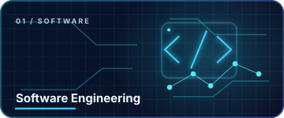
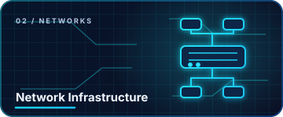
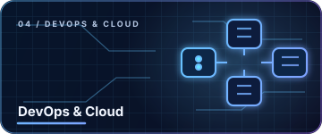
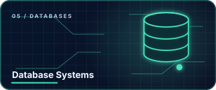
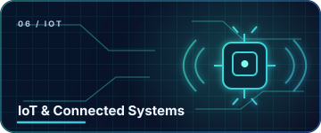

<!--
  GitHub Profile README for hieu-commits
  Repository name must be exactly: hieu-commits
  Upload this README.md and the full assets/ folder to the repository root.
-->

  

  
  
  

  <strong>Build with purpose. Understand the layers. Secure by design.</strong> 
  Software · Networks · Security · Automation · Data · Connected Systems · Cloud

---

## ◈ About Me

Hi, I'm **Hieu** — an IT enthusiast building a practical foundation across software and infrastructure. I'm interested in how applications, networks, data, connected devices and security controls work together as one system.

I learn by breaking complex topics into smaller pieces, building repeatable labs, debugging what fails, and documenting what I discover. I care about understanding *why* a system works — not just making it work once.

- 🧩 **Software Engineering & AI** — C/C++, Python, problem solving, readable code and AI/ML fundamentals
- 🌐 **Networking** — TCP/IP, routing, switching, VLANs and network troubleshooting
- 🛡️ **Cybersecurity** — traffic analysis, access control, hardening and defensive security
- ⚙️ **DevOps** — Linux, Git, automation, containers and CI/CD fundamentals
- 🗄️ **Databases** — SQL, relational modeling, queries and data integrity
- 📡 **IoT** — device connectivity, MQTT, telemetry and service integration
- ☁️ **Cloud** — infrastructure concepts, virtualization, deployment and observability

> My approach: **Understand → Design → Build → Test → Document → Improve.**

---

## ◈ Technical Stack

<table>
  <tr>
    <td width="50%" valign="top">
      <h3>⌘ Software Engineering & AI</h3>
      
      
      
      
      
      
      
      
    </td>
    <td width="50%" valign="top">
      <h3>⌁ Networking & Infrastructure</h3>
      
      
      
      
      
      
    </td>
  </tr>
  <tr>
    <td valign="top">
      <h3>⛨ Cybersecurity</h3>
      
      
      
      
      
    </td>
    <td valign="top">
      <h3>∞ DevOps & Cloud</h3>
      
      
      
      
      
    </td>
  </tr>
  <tr>
    <td valign="top">
      <h3>▤ Database Engineering</h3>
      
      
      
      
    </td>
    <td valign="top">
      <h3>⌁ IoT & Connected Systems</h3>
      
      
      
      
    </td>
  </tr>
</table>

These badges describe my technical focus and tools I explore. My repositories are the best place to evaluate hands-on work; I avoid presenting learning topics as certifications or mastery.

---

## ◈ Featured Project Tracks

These are project tracks and lab directions, not claims that every project is already complete. Replace each repository-list link with a direct project URL as you publish real work.

<table>
  <tr>
    <td width="33.33%" valign="top">
      
      <h3>01 / Software Engineering</h3>
      
Build readable programs, practice algorithms and data structures, and explore AI/ML through small, testable experiments.

      
 

      <a href="https://github.com/hieu-commits?tab=repositories">Explore repositories ↗</a>
    </td>
    <td width="33.33%" valign="top">
      
      <h3>02 / Network Infrastructure</h3>
      
Routing, switching, VLAN segmentation, WAN connectivity, firewall policy and repeatable troubleshooting labs.

      
 

      <a href="https://github.com/hieu-commits?tab=repositories">Explore repositories ↗</a>
    </td>
    <td width="33.33%" valign="top">
      
      <h3>03 / Cybersecurity</h3>
      
Packet inspection, network visibility, access control, security baselines and defensive testing in authorized labs.

      
 

      <a href="https://github.com/hieu-commits?tab=repositories">Explore repositories ↗</a>
    </td>
  </tr>
  <tr>
    <td width="33.33%" valign="top">
      
      <h3>04 / DevOps & Cloud</h3>
      
Versioned configuration, containers, CI/CD concepts, Linux services, deployment workflow and infrastructure fundamentals.

      
 

      <a href="https://github.com/hieu-commits?tab=repositories">Explore repositories ↗</a>
    </td>
    <td width="33.33%" valign="top">
      
      <h3>05 / Database Engineering</h3>
      
SQL queries, relational algebra, schema design, normalization and reliable data access.

      
 

      <a href="https://github.com/hieu-commits?tab=repositories">Explore repositories ↗</a>
    </td>
    <td width="33.33%" valign="top">
      
      <h3>06 / IoT & Connected Systems</h3>
      
Device-to-service communication, MQTT messaging, telemetry flows and integration with network services.

      
 

      <a href="https://github.com/hieu-commits?tab=repositories">Explore repositories ↗</a>
    </td>
  </tr>
</table>

---

## ◈ Engineering Workflow

  
  
  
  
  

- **Reproducible:** record commands, configs, assumptions and test steps.
- **Observable:** use logs, metrics or packet captures to understand behavior.
- **Secure-minded:** apply least privilege and test only in systems I own or am authorized to assess.
- **Maintainable:** prefer clear structure and useful documentation over unnecessary complexity.

---

## ◈ Current Learning Roadmap

- [ ] Improve C/C++ fundamentals, pointers, memory and data structures.
- [ ] Build practical Python utilities with input validation and tests.
- [ ] Run small AI/ML experiments with clear baselines and evaluation criteria.
- [ ] Document network and firewall labs with diagrams and troubleshooting notes.
- [ ] Practice SQL, relational modeling and query design.
- [ ] Explore secure deployment workflows, containers and cloud fundamentals.
- [ ] Develop a small IoT-to-service flow with MQTT and telemetry.

---

## ◈ GitHub Activity

  
  

  

<!--
  OPTIONAL CONTRIBUTION SNAKE
  Uncomment this block only after the snake workflow has successfully created
  the output branch and both SVG files in this repository.

  <picture>
    <source media="(prefers-color-scheme: dark)" srcset="https://raw.githubusercontent.com/hieu-commits/hieu-commits/output/github-contribution-grid-snake-dark.svg" />
    
  </picture>

-->

---

  <strong>Think in systems. Build with purpose. Secure by design.</strong> 
  Software · Networking · Cybersecurity · DevOps · Databases · IoT · Cloud

  
  

