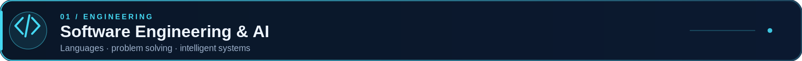
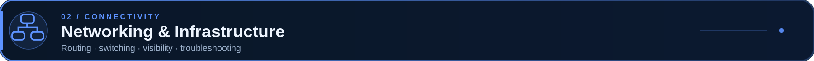
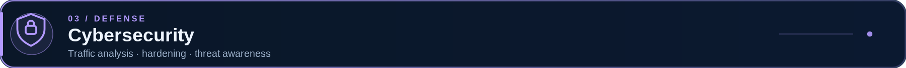
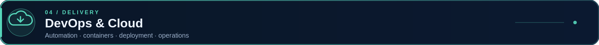
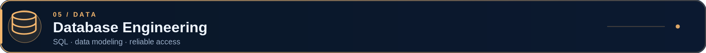
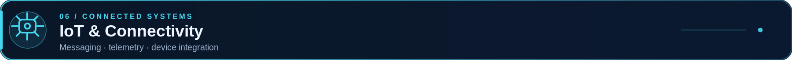

<!--
GitHub Profile README for hieu-commits.
Copy README.md and the complete assets/ folder into the hieu-commits repository.
This package intentionally does not include/replace .github/workflows/snake.yml.
-->

  

<h1 align="center">👋 Hi there, I'm Huỳnh Nhật Hiếu!</h1>

  <strong>Software Engineering &amp; Computer Science student at HCMUS</strong> 
  IT Systems &amp; Network Administrator&nbsp;&nbsp; 🔴 🟡 🟢

  <strong>Software Engineer | Telecom Networks, Cyber Security, AI, IoT &amp; DevOps</strong> 
  🔴 &nbsp; 🟡 &nbsp; 🟢

  <a href="https://github.com/hieu-commits">GitHub Profile</a>&nbsp;&nbsp;·&nbsp;&nbsp;
  <a href="https://hieu-commits.github.io">Portfolio Website</a>&nbsp;&nbsp;·&nbsp;&nbsp;
  <a href="https://github.com/hieu-commits?tab=repositories">Repositories</a>

  <em>Build with purpose. Understand the layers. Secure by design.</em>

---

## About Me

I'm **Huỳnh Nhật Hiếu** (`hieu-commits`), a Software Engineering &amp; Computer Science student interested in building reliable software and understanding the systems around it—from networks and infrastructure to security, data, IoT and cloud platforms.

I prefer hands-on learning: implement a small solution, test it, document the result, and improve it. I value readable code, reproducible labs, careful troubleshooting and security-minded design over buzzwords.

**Current focus:** C/C++, Python, AI/ML fundamentals, network engineering, defensive and authorized security labs, DevOps automation, SQL/database design, IoT communication and cloud fundamentals.

---

## Technical Stack

*Technology badges use each tool's recognizable mark where available. Spacing is deliberate so the rows remain easy to scan.*

  &nbsp;&nbsp;
  &nbsp;&nbsp;
  &nbsp;&nbsp;
  &nbsp;&nbsp;
  &nbsp;&nbsp;
  &nbsp;&nbsp;
  &nbsp;&nbsp;
  &nbsp;&nbsp;
  &nbsp;&nbsp;
  &nbsp;&nbsp;
  &nbsp;&nbsp;
  

  &nbsp;&nbsp;
  &nbsp;&nbsp;
  &nbsp;&nbsp;
  &nbsp;&nbsp;
  &nbsp;&nbsp;
  &nbsp;&nbsp;
  &nbsp;&nbsp;
  

  &nbsp;&nbsp;
  &nbsp;&nbsp;
  &nbsp;&nbsp;
  &nbsp;&nbsp;
  &nbsp;&nbsp;
  &nbsp;&nbsp;
  &nbsp;&nbsp;
  &nbsp;&nbsp;
  &nbsp;&nbsp;
  &nbsp;&nbsp;
  

  &nbsp;&nbsp;
  &nbsp;&nbsp;
  &nbsp;&nbsp;
  &nbsp;&nbsp;
  &nbsp;&nbsp;
  &nbsp;&nbsp;
  &nbsp;&nbsp;
  &nbsp;&nbsp;
  

  &nbsp;&nbsp;
  &nbsp;&nbsp;
  &nbsp;&nbsp;
  &nbsp;&nbsp;
  &nbsp;&nbsp;
  

  &nbsp;&nbsp;
  &nbsp;&nbsp;
  &nbsp;&nbsp;
  &nbsp;&nbsp;
  &nbsp;&nbsp;
  

---

## Featured Project Tracks

The cards below represent **project directions and lab tracks**, not claims that every project is already complete. Until a dedicated repository is ready, each card opens the repository list. Replace the links with direct project URLs when you publish the code and documentation.

<table>
  <tr>
    <td width="33.33%" valign="top">
      

      <h3>🛡️ RedTeam-Pentest-Lab</h3>
      
Authorized lab scenarios for vulnerability assessment, service discovery, traffic inspection and documenting findings.

      

        
        
        
      

      
Status: Lab track / in progress

      <a href="https://github.com/hieu-commits?tab=repositories">Explore repositories ↗</a>
    </td>
    <td width="33.33%" valign="top">
      

      <h3>⚙️ DevSecOps-Pipeline</h3>
      
A planned CI/CD learning track combining container builds, infrastructure as code, automated checks and deployment security.

      

        
        
        
      

      
Status: Blueprint / learning track

      <a href="https://github.com/hieu-commits?tab=repositories">Explore repositories ↗</a>
    </td>
    <td width="33.33%" valign="top">
      

      <h3>🔎 BlueTeam-SIEM-Deploy</h3>
      
A defensive monitoring track covering packet analysis, IDS/IPS concepts, alert triage and documenting suspicious activity.

      

        
        
        
      

      
Status: Lab track / in progress

      <a href="https://github.com/hieu-commits?tab=repositories">Explore repositories ↗</a>
    </td>
  </tr>
</table>

---

## Technical Notes &amp; Learning Roadmap

These are topics I plan to document as practical notes or articles. They are **not presented as published articles** until a public link is added.

- 📄 **Advanced Penetration Testing with Kali Linux and Metasploit** — draft topic
- 📄 **Implementing DevSecOps: Securing Kubernetes Deployments** — draft topic
- 📄 **Network Traffic Analysis for Blue Teams using Wireshark and Snort** — draft topic

When an article is published, replace the topic text with a link to the article and add the actual publication date.

---

## Engineering Principles

- **Readable:** use clear naming, focused functions and useful documentation.
- **Reproducible:** record setup steps, assumptions, commands and test cases.
- **Observable:** use logs, metrics and packet captures to understand behavior.
- **Secure-minded:** apply least privilege and test only systems I own or am authorized to assess.
- **Evidence over claims:** show code, tests, architecture and results whenever possible.

## Learning Roadmap

- [ ] Strengthen C/C++, pointers, memory and data structures.
- [ ] Build Python tools with validation, tests and helpful error handling.
- [ ] Run small AI/ML experiments with documented baselines and evaluation.
- [ ] Document routing, VLAN, firewall and troubleshooting labs.
- [ ] Practice SQL, relational modeling, normalization and query design.
- [ ] Explore containers, CI/CD, infrastructure as code and cloud fundamentals.
- [ ] Build a small MQTT telemetry pipeline and document its security model.

---

## My GitHub Contributions Summary

  &nbsp;&nbsp;
  

  

  

<!-- This image block is intentionally active. The snake workflow publishes SVGs to the output branch. -->

  <picture>
    <source media="(prefers-color-scheme: dark)" srcset="https://raw.githubusercontent.com/hieu-commits/hieu-commits/output/github-contribution-grid-snake-dark.svg" />
    <source media="(prefers-color-scheme: light)" srcset="https://raw.githubusercontent.com/hieu-commits/hieu-commits/output/github-contribution-grid-snake.svg" />
    
  </picture>

---

  <strong>Think in systems. Build with purpose. Secure by design.</strong> 
  Software Engineering · Networking · Cybersecurity · DevOps · Databases · IoT · Cloud  
  <a href="https://github.com/hieu-commits">GitHub</a>&nbsp;&nbsp;·&nbsp;&nbsp;
  <a href="https://hieu-commits.github.io">Portfolio</a>

