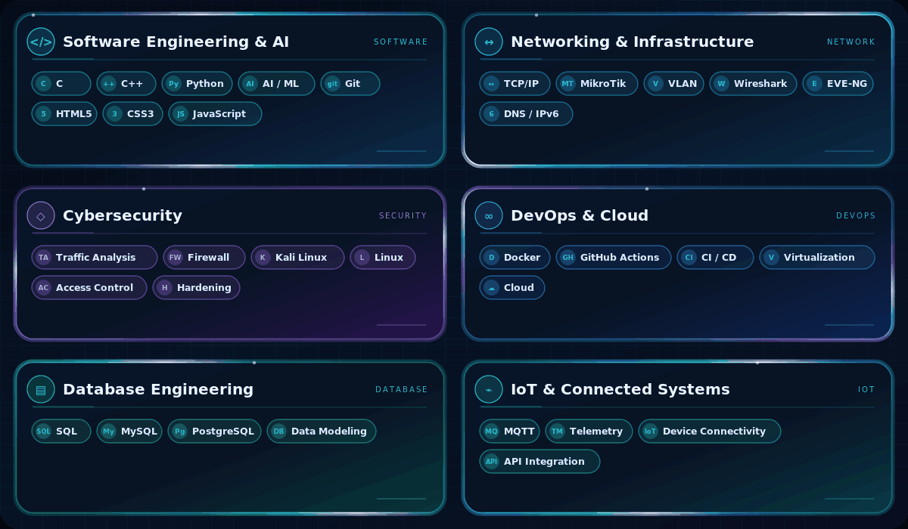
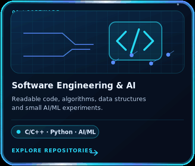
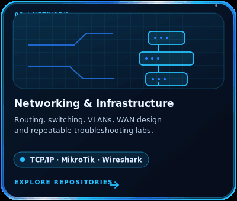
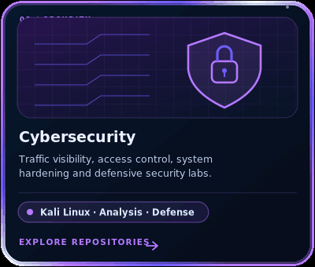
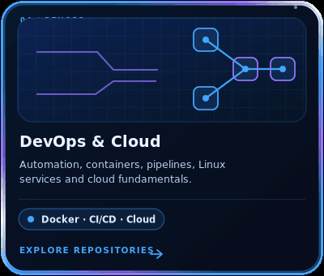
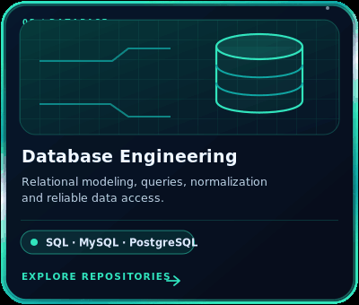
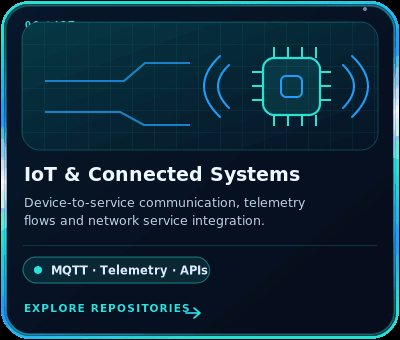

<!-- Profile README for hieu-commits. Keep assets/ alongside this file. -->

  

  <a href="https://github.com/hieu-commits">◉ GitHub · hieu-commits</a>
  &nbsp;✦&nbsp;
  <a href="https://hieu-commits.github.io">↗ Portfolio Website</a>
  &nbsp;✦&nbsp;
  ⌘ Systems Thinking

  <strong>Build with purpose. Understand the layers. Secure by design.</strong> 
  Software · Networks · Security · Automation · Data · Connected Systems · Cloud

---

## ◈ About Me

Hi, I'm **Hieu** — an IT enthusiast building a practical foundation across software and infrastructure. I'm interested in how applications, networks, data, connected devices and security controls work together as one system.

I learn by breaking complex topics into smaller pieces, building repeatable labs, debugging what fails, and documenting what I discover. I care about understanding *why* a system works — not just making it work once.

- 🧩 **Software Engineering & AI** — C/C++, Python, problem solving, readable code and AI/ML fundamentals
- 🌐 **Networking** — TCP/IP, routing, switching, VLANs and network troubleshooting
- 🛡️ **Cybersecurity** — traffic analysis, access control, hardening and defensive security
- ⚙️ **DevOps** — Linux, Git, automation, containers and CI/CD fundamentals
- 🗄️ **Databases** — SQL, relational modeling, queries and data integrity
- 📡 **IoT** — device connectivity, MQTT, telemetry and service integration
- ☁️ **Cloud** — infrastructure concepts, virtualization, deployment and observability

> **Approach:** Understand → Design → Build → Test → Document → Improve.

---

## ◈ Technical Stack

Each category has its own soft glass panel, rounded neon border and a subtle moving glow. These are focus areas and tools I explore, not claims of certification.

  

---

## ◈ Featured Project Tracks

These cards describe project tracks and lab directions. They are not claims that every project is already complete; each card links to my repositories so you can inspect published work.

  &nbsp;&nbsp;

  &nbsp;&nbsp;

---

## ◈ Engineering Workflow

<strong>01 Understand</strong> &nbsp; ⟶ &nbsp; <strong>02 Design</strong> &nbsp; ⟶ &nbsp; <strong>03 Build</strong> &nbsp; ⟶ &nbsp; <strong>04 Test</strong> &nbsp; ⟶ &nbsp; <strong>05 Document</strong>

- **Reproducible:** record commands, configurations, assumptions and test steps.
- **Observable:** use logs, metrics or packet captures to understand behavior.
- **Secure-minded:** apply least privilege and test only in systems I own or am authorized to assess.
- **Maintainable:** prefer clear structure and useful documentation over unnecessary complexity.

---

## ◈ Current Learning Roadmap

- [ ] Improve C/C++ fundamentals, pointers, memory and data structures.
- [ ] Build practical Python utilities with input validation and tests.
- [ ] Run small AI/ML experiments with clear baselines and evaluation criteria.
- [ ] Document network and firewall labs with diagrams and troubleshooting notes.
- [ ] Practice SQL, relational modeling and query design.
- [ ] Explore secure deployment workflows, containers and cloud fundamentals.
- [ ] Develop a small IoT-to-service flow with MQTT and telemetry.

---

## ◈ GitHub Activity

  
  

  

<!-- Contribution Snake is shown only if the output branch contains both SVGs. -->

  <picture>
    <source media="(prefers-color-scheme: dark)" srcset="https://raw.githubusercontent.com/hieu-commits/hieu-commits/output/github-contribution-grid-snake-dark.svg" />
    <source media="(prefers-color-scheme: light)" srcset="https://raw.githubusercontent.com/hieu-commits/hieu-commits/output/github-contribution-grid-snake.svg" />
    
  </picture>

---

  <strong>Think in systems. Build with purpose. Secure by design.</strong> 
  Software · Networking · Cybersecurity · DevOps · Databases · IoT · Cloud

  <a href="https://github.com/hieu-commits">Connect on GitHub ↗</a>
  &nbsp;✦&nbsp;
  <a href="https://hieu-commits.github.io">Explore Portfolio ↗</a>

