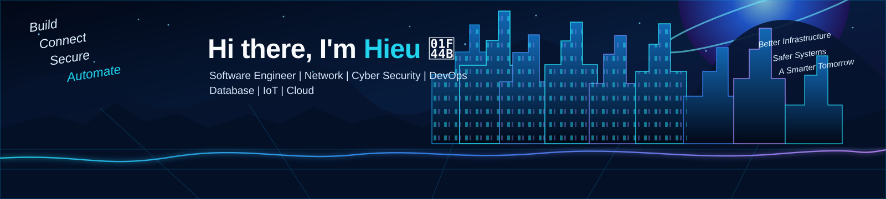
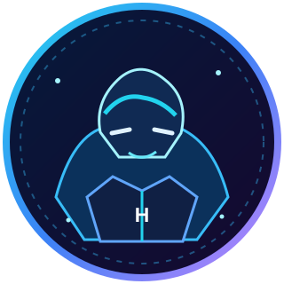

  

<!-- PROFILE HEADER (FULL WIDTH, CENTERED) -->

   
  <b><code style="font-size: 1.5em;">hieu-commits</code></b> 
  IT enthusiast | Always learning | Always building 
  📍 Vietnam &nbsp;·&nbsp; ✉️ <a href="mailto:hieu-commits@gmail.com">hieu-commits@gmail.com</a>

  
  

  <i>“Technology is not just about code; it's about solving real-world problems.”</i>

 

<!-- TECH STACK -->
<b>〈/〉 Tech Stack</b>
<table width="100%" border="0" cellspacing="4" cellpadding="4">
  <tr>
    <td align="center">
       Software Engineering
    </td>
    <td align="center">
       🌐 Networking
    </td>
    <td align="center">
       🛡️ Cybersecurity
    </td>
    <td align="center">
       DevOps
    </td>
    <td align="center">
       Database
    </td>
    <td align="center">
       IoT & Cloud
    </td>
  </tr>
</table>
 

<!-- FEATURED PROJECTS -->
<b>🗂️ Featured Projects</b>
<table width="100%" border="0" cellspacing="4" cellpadding="4">
  <tr>
    <td width="33%" valign="top">
      
      <h4>Network Infrastructure Lab ↗</h4>
      
Routing, switching, VLAN, firewall policies and network automation.

    </td>
    <td width="33%" valign="top">
      
      <h4>IoT Connectivity Platform ↗</h4>
      
Build IoT solutions with MQTT, device management and cloud.

    </td>
    <td width="33%" valign="top">
      
      <h4>Cybersecurity & Automation ↗</h4>
      
Security analysis, threat detection and automation with modern tools.

    </td>
  </tr>
</table>
 

<!-- CONTRIBUTIONS & GOALS (HORIZONTAL SCROLL FORMAT) -->
<b>🔥 Contributions & Future Goals</b>

<i>(Scroll horizontally to view more)</i>

<table border="0" cellspacing="4" cellpadding="8" style="white-space: nowrap;">
  <tr>
    <td valign="top" style="min-width: 250px;">
      <b>My Recent Articles / Notes</b> 
      📝 Secure Network Design (VLAN & Firewall) 
      📝 Mail Protocol Simulator (SMTP/IMAP) 
      📝 Windows IT Dashboard Automation 
      📝 MikroTik Multi-WAN Lab Failover
    </td>
    <td valign="top" style="min-width: 400px;">
      <b>GitHub Contributions</b> 
      
    </td>
    <td valign="top" style="min-width: 250px;">
      <b>🚀 Future Goals</b> 
      <b>01 /</b> Design resilient enterprise networks. 
      <b>02 /</b> Build secure MQTT cloud architectures. 
      <b>03 /</b> Advanced ethical testing & threat response. 
    </td>
  </tr>
</table>

 

L E A R N &nbsp; · &nbsp; B U I L D &nbsp; · &nbsp; G R O W

