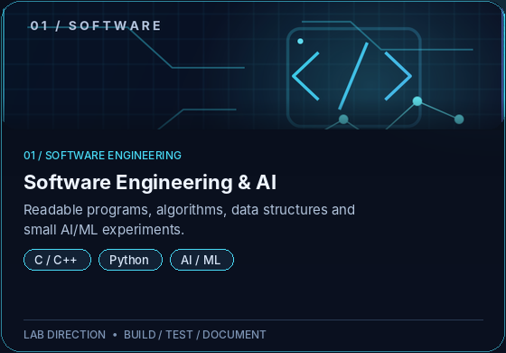
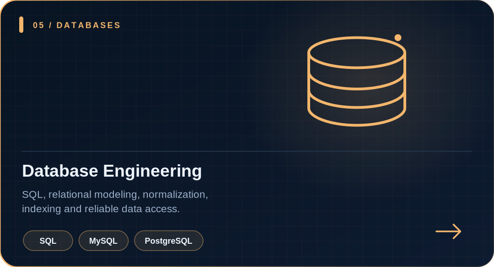
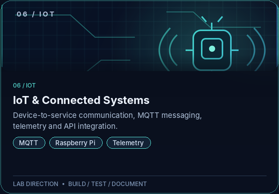

<!-- GitHub Profile README for hieu-commits. Keep the assets/ folder beside this file. -->

  

  <a href="https://github.com/hieu-commits">GitHub</a>
  &nbsp;&nbsp;·&nbsp;&nbsp;
  <a href="https://hieu-commits.github.io">Portfolio</a>
  &nbsp;&nbsp;·&nbsp;&nbsp;
  <a href="https://github.com/hieu-commits?tab=repositories">Repositories</a>

  <strong>Build with purpose. Understand the layers. Secure by design.</strong> 
  Software · Networks · Cybersecurity · DevOps · Data · IoT · Cloud

---

## About me

Hi, I'm **Hieu** — an IT enthusiast focused on understanding how software, networks, data, security and cloud infrastructure work together.

I learn by building small, repeatable projects, testing what fails, documenting the results and improving the design. I value clear reasoning, reliable systems and practical evidence over buzzwords.

**Current focus:** software fundamentals with C/C++ and Python, AI/ML experiments, network engineering, defensive security, automation, databases and connected systems.

---

## Technical stack

A carefully spaced, static overview. Each technology uses its own recognizable mark where available; the layout groups related tools in separate rounded panels instead of a dense table of touching badges.

  

### Security & network vendor marks

  
  &nbsp;&nbsp;&nbsp;
  
  &nbsp;&nbsp;&nbsp;
  
  &nbsp;&nbsp;&nbsp;
  
  &nbsp;&nbsp;&nbsp;
  
  &nbsp;&nbsp;&nbsp;
  

---

## Project tracks

These are directions for practical lab work, not claims that every project is complete. I will link each card to its own repository as the implementation becomes public.

  &nbsp;&nbsp;
  &nbsp;&nbsp;
  

  &nbsp;&nbsp;
  &nbsp;&nbsp;
  

---

## Engineering principles

- **Reproducible:** document commands, configurations, assumptions and test steps.
- **Observable:** use logs, metrics and packet captures to understand behavior.
- **Secure-minded:** follow least privilege and test only systems I own or am authorized to assess.
- **Maintainable:** prioritize clarity, tests and useful documentation over unnecessary complexity.

## Learning roadmap

- [ ] Strengthen C/C++, pointers, memory and data structures.
- [ ] Build Python utilities with validation and tests.
- [ ] Run small AI/ML experiments with clear baselines and evaluation.
- [ ] Document routing, VLAN, firewall and troubleshooting labs.
- [ ] Practice SQL, relational modeling and query design.
- [ ] Explore secure deployment, containers, CI/CD and cloud fundamentals.
- [ ] Build a small MQTT telemetry pipeline and document its security model.

---

## GitHub activity

  &nbsp;&nbsp;
  

  

<!-- Contribution Snake: keep active while the output branch contains the SVG files. -->

  <picture>
    <source media="(prefers-color-scheme: dark)" srcset="https://raw.githubusercontent.com/hieu-commits/hieu-commits/output/github-contribution-grid-snake-dark.svg" />
    <source media="(prefers-color-scheme: light)" srcset="https://raw.githubusercontent.com/hieu-commits/hieu-commits/output/github-contribution-grid-snake.svg" />
    
  </picture>

---

  <strong>Think in systems. Build with purpose. Secure by design.</strong> 
  Software · Networking · Cybersecurity · DevOps · Databases · IoT · Cloud  
  <a href="https://github.com/hieu-commits">GitHub</a>
  &nbsp;&nbsp;·&nbsp;&nbsp;
  <a href="https://hieu-commits.github.io">Portfolio</a>

